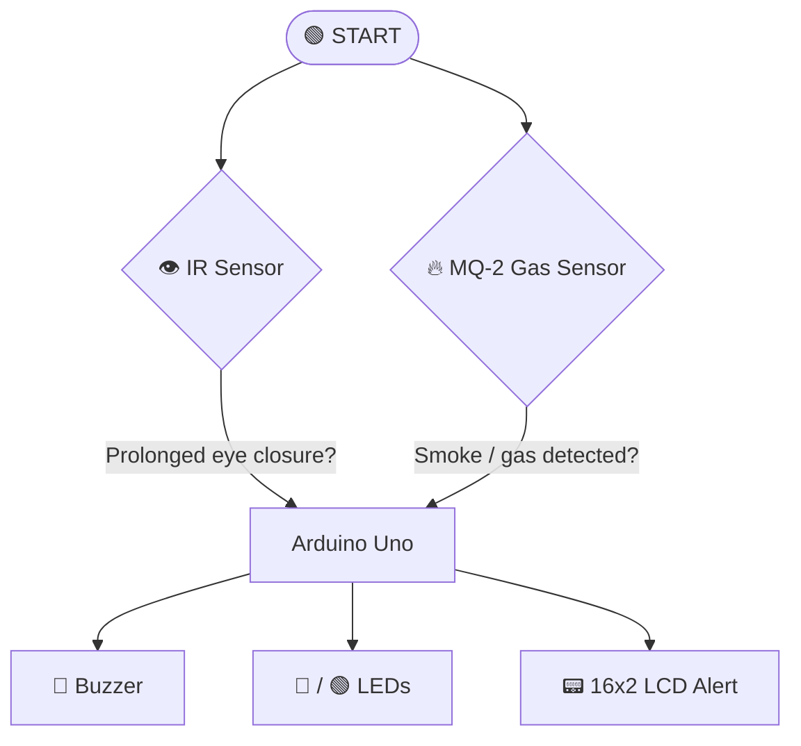

<div align="center">

# 🚗 Safe Drive: Accident Prevention System

### *Arduino-based real-time driver fatigue and fire/smoke detection*


**Mini Project I · SY Sem-III · Electronics & Telecommunication Engineering**
*Pillai College of Engineering (Autonomous), University of Mumbai*

[Overview](#-overview) · [Features](#-features) · [How It Works](#-how-it-works) · [Hardware](#-hardware-required) · [Wiring](#-pin-connections) · [Setup](#-getting-started) · [Future Scope](#-future-scope) · [Team](#-team)

</div>

---

## 📖 Overview

Road accidents are often caused by **driver fatigue** and **undetected engine or cabin fires**. Most existing safety systems are either expensive or monitor only one of these risks.

**Safe Drive** is a low-cost, Arduino-powered system that watches both at once:

- 👁️ An **IR eye-blink sensor** tracks eyelid movement to detect drowsiness.
- 🔥 An **MQ-2 smoke/gas sensor** detects smoke and combustible gas from the engine compartment.
- 🚨 A **buzzer, LEDs and an LCD** alert the driver instantly, so they can act before it becomes an accident.

---

## ✨ Features

| | Feature | Description |
|---|---|---|
| 😴 | **Drowsiness detection** | Flags prolonged eye closure using an IR sensor |
| 🔥 | **Smoke and gas detection** | MQ-2 senses smoke, LPG, propane, methane and hydrogen |
| 🔔 | **Audio alert** | Loud buzzer to wake or warn the driver |
| 💡 | **Visual status** | Green LED for safe, red LED for danger |
| 📟 | **LCD warnings** | 16x2 display shows the alert message |
| ⚡ | **Real-time response** | Continuous monitoring with instant alerts |
| 💰 | **Low cost** | Built from affordable, easy-to-find components |

---

## ⚙️ How It Works



**Block diagram**

```
 ┌──────────────┐                      ┌────────────┐
 │ 🔥 MQ-2 Smoke │──────┐       ┌─────▶│ 🔔 Buzzer   │
 │    Sensor    │      ▼       │      └────────────┘
 └──────────────┘  ┌─────────┐ │      ┌────────────┐
                   │ ARDUINO │─┼─────▶│ 💡 LEDs     │
 ┌──────────────┐  │   UNO   │ │      └────────────┘
 │ 👁️ IR Eye-Blink│─▶└─────────┘ │      ┌────────────┐
 │    Sensor    │              └─────▶│ 📟 16x2 LCD │
 └──────────────┘                     └────────────┘
```

**Logic**

1. The **IR sensor** sits near the driver's eyes and monitors blink timing and closure duration.
2. If the eyes stay closed too long, the buzzer sounds, the **red LED** turns on, the green LED turns off and the LCD shows a drowsiness alert.
3. The **MQ-2 sensor** in the engine compartment continuously reads the air.
4. If the reading crosses a preset threshold, the buzzer sounds and the LCD shows a smoke or gas warning.
5. Otherwise the **green LED** stays on and everything is normal.

---

## 🧰 Hardware Required

| Component | Qty | Purpose |
|---|:---:|---|
| Arduino Uno (ATmega328P) | 1 | Main controller |
| MQ-2 Gas/Smoke Sensor | 1 | Smoke and gas detection |
| IR Eye-Blink Sensor | 1 | Drowsiness detection |
| Active Buzzer | 1 | Audio alert |
| 16x2 LCD (HD44780) | 1 | Text alerts |
| Red and Green LEDs | 1 each | Status indication |
| Resistors | few | Current limiting for LEDs |
| Potentiometer | 1 | LCD contrast |
| DC Motor | 1 | Simulates the vehicle or engine |
| 12 V Battery / Supply | 1 | Power |
| Breadboard and Jumper Wires | - | Prototyping |

**Software:** [Arduino IDE](https://www.arduino.cc/en/software)

---

## 🔌 Pin Connections

| Component | Arduino Pin |
|---|---|
| IR Sensor (OUT) | `D3` |
| MQ-2 (Analog Out) | `A0` |
| Buzzer | `D10` |
| Green LED | `D12` |
| Red LED | `D11` |
| DC Motor | `D13` *(use a motor driver for higher loads)* |
| LCD control and data | `D4` to `D9` |
| Sensors VCC / GND | `5V` / `GND` |

> 💡 Use appropriate resistors on the LEDs. Calibrate the MQ-2 threshold for your environment, since readings vary with air conditions.

---

## 🚀 Getting Started

```bash
# 1. Clone the repository
git clone https://github.com/<your-username>/accident-prevention-system.git
cd accident-prevention-system
```

1. Assemble the circuit on a breadboard using the pin table above.
2. Open the `.ino` sketch in the **Arduino IDE**.
3. Select **Tools → Board → Arduino Uno** and the correct **COM port**.
4. Click **Upload**.
5. Power the board via USB or an external supply.

### 🧪 Testing

| Test | Expected result |
|---|---|
| Close your eyes in front of the IR sensor | Buzzer ON, red LED ON, green LED OFF, LCD alert |
| Bring smoke near the MQ-2 | Buzzer ON, LCD smoke warning |
| Normal conditions | Green LED ON, no alarm |

---

## 🗂️ Repository Structure

```
accident-prevention-system/
├── src/
│   └── accident_prevention.ino    # Arduino sketch
├── docs/
│   └── Report.pdf                 # Full project report
├── images/
│   ├── block-diagram.png
│   └── circuit-diagram.png
└── README.md
```

---

## 🌍 Applications

- 🚘 **Automotive:** personal vehicles, with driver fatigue and fire alerts
- 🚛 **Commercial transport:** fleet monitoring and hazardous-material vehicles
- 🏗️ **Industrial and construction machinery:** operator alertness and smoke detection
- 🚌 **Public transport:** driver fatigue monitoring and passenger safety
- ⌚ **Wearables:** personal fatigue and hazard alerts
- 🏠 **Smart homes:** smoke monitoring and distress detection for the elderly

---

## 🔮 Future Scope

- 🛣️ Integration with **ADAS** (lane-keeping, adaptive cruise control, collision avoidance)
- 🤖 **AI/ML** for blink-pattern analysis, fatigue prediction and fewer false alarms
- 🌐 **IoT connectivity** for remote fleet and family monitoring
- 🧪 **Expanded sensors:** alcohol, heart rate, body temperature and air quality
- ⚙️ User-adjustable alert thresholds with adaptive learning
- 🚑 Automatic **emergency response** with location sharing
- ⌚ Smartwatch and fitness-tracker integration

---

## 👥 Team

| Roll No. | Name |
|:---:|---|
| 325 | Mishra Jyotilipsa |
| 326 | More Manasvi Vivek |
| 324 | Maurya Harsh Rakesh |
| 341 | Bisht Chandranshu Ramesh |
| 323 | Mahek |

**🎓 Guide:** Prof. Sweta Waghmare
**🏫 Institution:** Mahatma Education Society's Pillai College of Engineering (Autonomous), Dr. K. M. Vasudevan Pillai Campus, New Panvel
**🎓 University:** University of Mumbai

---

## 📚 References

1. Arduino Uno overview: [arduino.cc](https://www.arduino.cc/en/Guide/Introduction)
2. Ponnle & Ogunniyi (2016). *Development of Driver Fatigue Detection System Based on Eye Blink Patterns.* IJERT, 5(7)
3. Hanwei Electronics. *MQ-2 Gas Sensor Technical Data.*
4. Coelho & Silva (2018). *Design of a Smoke Detection and Alarm System.* IEEE Trans. Consumer Electronics
5. Litman, T. (2020). *Automated Vehicles: Implementation Predictions.* VTPI
6. Robert Bosch GmbH (2017). *Advanced Driver Assistance Systems.* Bosch Automotive Handbook
7. Karuppuswamy & Sankari (2020). *Real-Time Driver Monitoring System Using Wearable Devices and IoT.*
8. Rueda & Yadav (2021). *Leveraging AI for Enhanced Road Safety: A Review.*

---

<div align="center">

⭐ **If you found this project useful, consider giving it a star!** ⭐

*Built with ❤️ for safer roads.*

</div>
